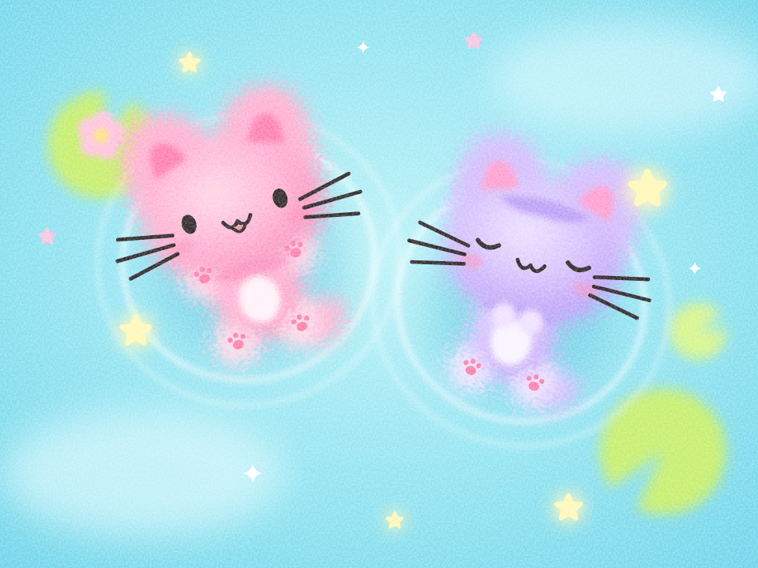
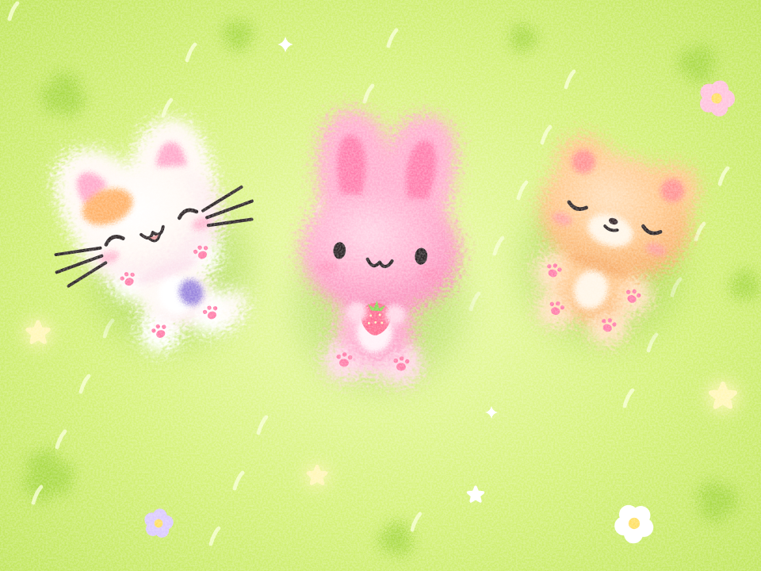
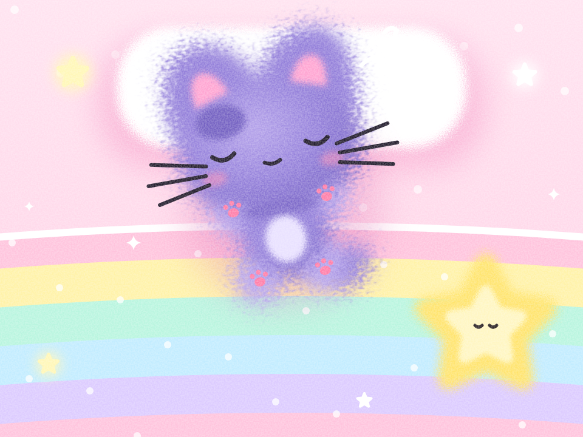

# Marshmallow Chibi · belly-up chibi SVG

| Pond Float | Clover Nap | Rainbow Quilt |
|:---:|:---:|:---:|
|  |  |  |

Big-headed, tiny-bodied animals napping on their backs, seen from above. **Silhouettes feather out into loose fibres; eyes, ω mouths, whiskers and toe beans stay crisp** — thick, round-ended lines, wide-set eyes with no highlights, a big ω mouth. Bright dopamine candy colours, marshmallow-plump limbs and ears, hard stars with soft glows.

**In a chat window**, upload `SKILL.md` and describe the animals and where they're lying. Attach `references/template.svg` to start from a finished card.

The blur melts simple ellipses and thick round strokes into one plush form, so the body shapes never need to be precise — only a handful of ink marks do, and their coordinates are given in `SKILL.md`. That makes the style forgiving for any model that can write basic SVG.

**Locally**: `scripts/marshmallow.mjs` builds animals and decor, `node scripts/build-examples.mjs` rebuilds the examples, `node scripts/render.mjs` renders PNGs (Playwright, or a local Chrome as fallback), `node scripts/lint.mjs` checks a card.
