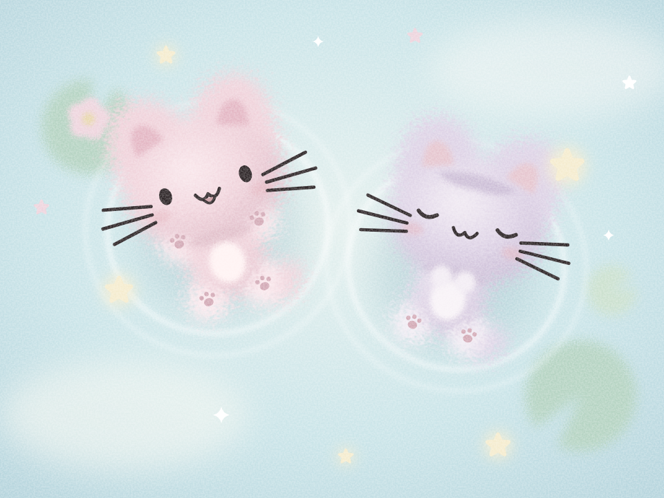
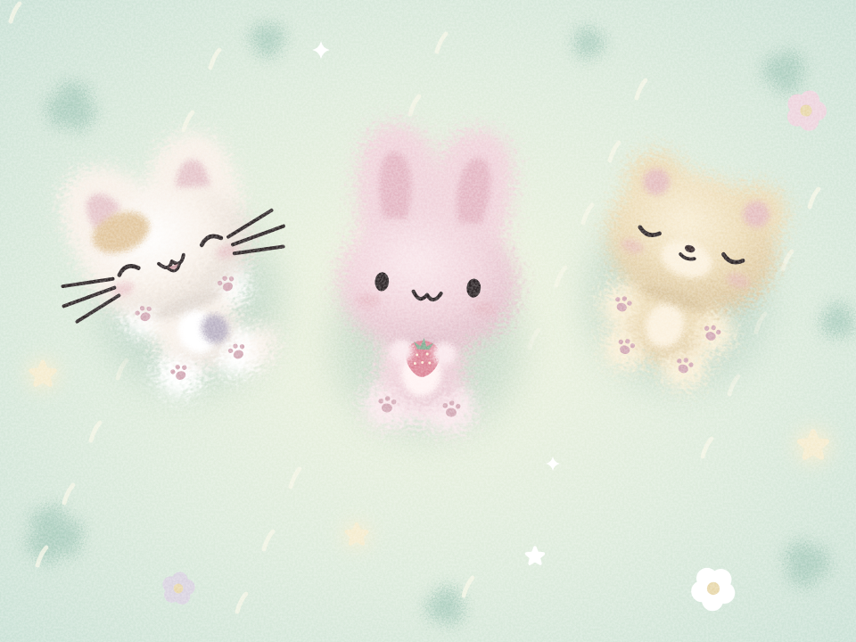
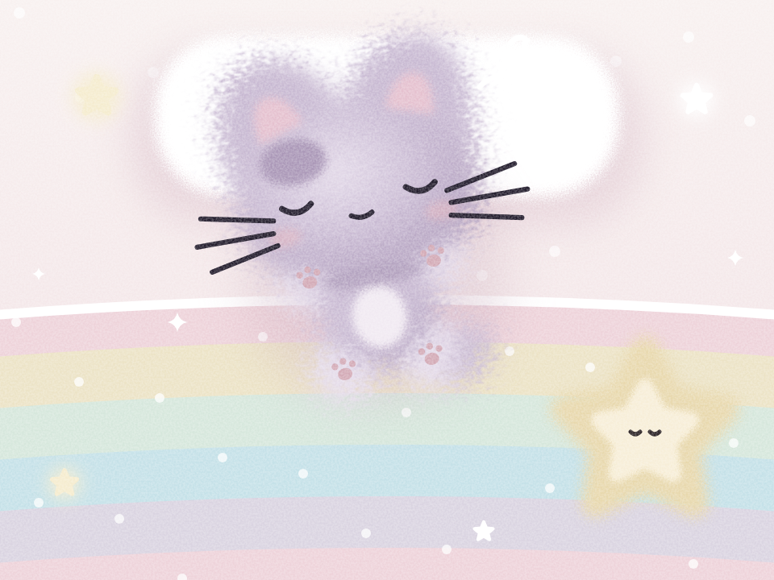

# Marshmallow Chibi · 棉花糖小动物 SVG

| 池塘漂漂 | 三叶草午睡 | 彩虹被子 |
|:---:|:---:|:---:|
|  |  |  |

大头小身子、仰面躺着的圆滚滚小动物，从正上方俯视。**耳尖、两腮和脚掌外缘散成细软的绒毛，眼睛、ω 嘴、胡须和肉垫保持清晰。** 线条一律加粗、圆头，眼睛不加高光、间距开得很宽，嘴巴大一点，整体是钝钝的笨萌感。 例图采用草莓奶粉、浅薄荷绿和奶油黄，整体造型像棉花糖：四肢粗短，耳朵鼓鼓囊囊，没有细条和尖角。装饰元素硬边星星和柔光混用。

**聊天窗**只需上传 `SKILL.md`，告诉它几只什么动物、在什么地方躺着。想从现成卡片改起，附上 `references/template.svg`。

## 为什么这套风格对 AI 友好

模糊会把椭圆和粗圆头线条融成一整团毛绒，所以身体形状不需要画得很准；需要精确的只有少数几笔清晰线条（眼睛、嘴、胡须、肉垫），这些在 `SKILL.md` 里都直接给了坐标。

## 三层画法

| 层 | 滤镜 | 内容 |
|---|---|---|
| 柔边层 SOFT | 双层绒边，细碎的外绒包住柔软的内层 | 头、身体、四肢、耳朵、尾巴 |
| 中间层 MID | 模糊 1.8 + 位移 6 | 肚皮、花纹、耳内、下巴阴影、腮红 |
| 墨线层 INK | 无 | 眼睛、嘴、胡须、肉垫、抱着的小物 |

“仰面躺”靠三个信号：**肉垫朝上露出来、后腿外八、整只身体倾斜**。每只至少保留两个。

最后整张卡片叠一层极淡的**白色**颗粒，模拟柔焦照片的质感（灰色颗粒会把颜色弄脏）。

## 本地生成

- `scripts/marshmallow.mjs`：组装动物（猫/兔/熊/狗，4 种眼型、4 种嘴、4 种手势）和星星、花、三叶草、荷叶
- `node scripts/build-examples.mjs`：重建三张示例
- `node scripts/render.mjs card.svg card.png`：渲染 PNG（有 Playwright 用 Playwright，没有就调用本机 Chrome/Chromium）
- `node scripts/lint.mjs card.svg --prefix xx-`：检查结构、滤镜、ID 和配色

## 微调

参数在 `style.json`。最常见的两个问题：**颜色发脏**（混进了灰、米、棕，阴影也要用同色系的深色而不是灰色），以及**动物和背景同色系**（粉猫配粉床会糊成一片，要换不同色相）。身体要保持非常小（不到头宽的一半）。修改默认画法时，同步 `SKILL.md`、`scripts/marshmallow.mjs` 和 `references/template.svg`。
